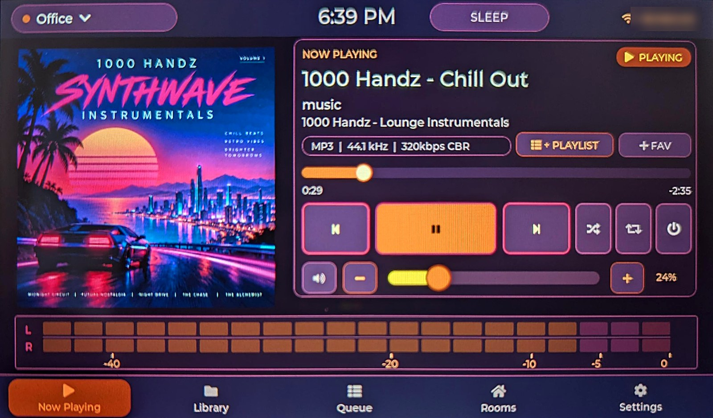
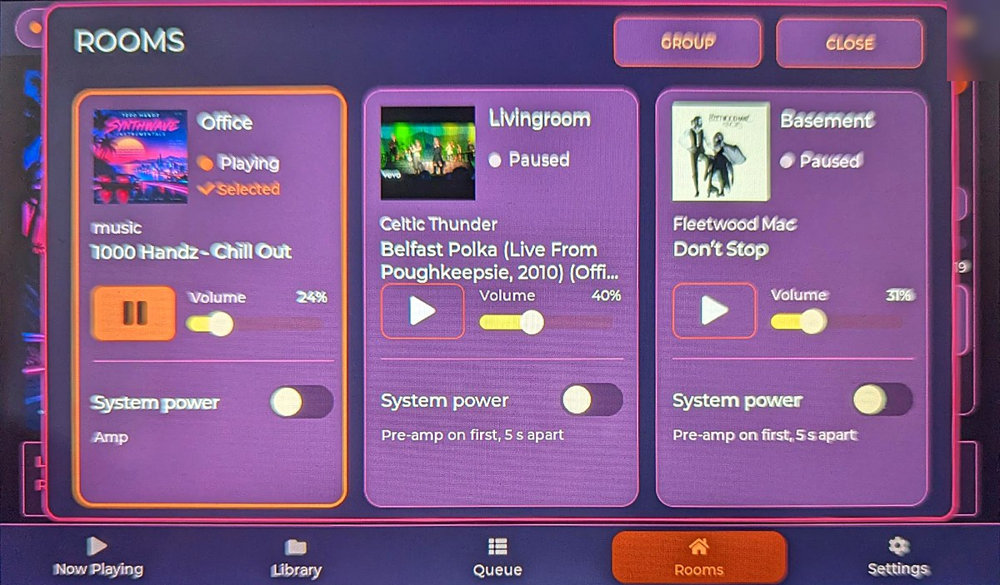
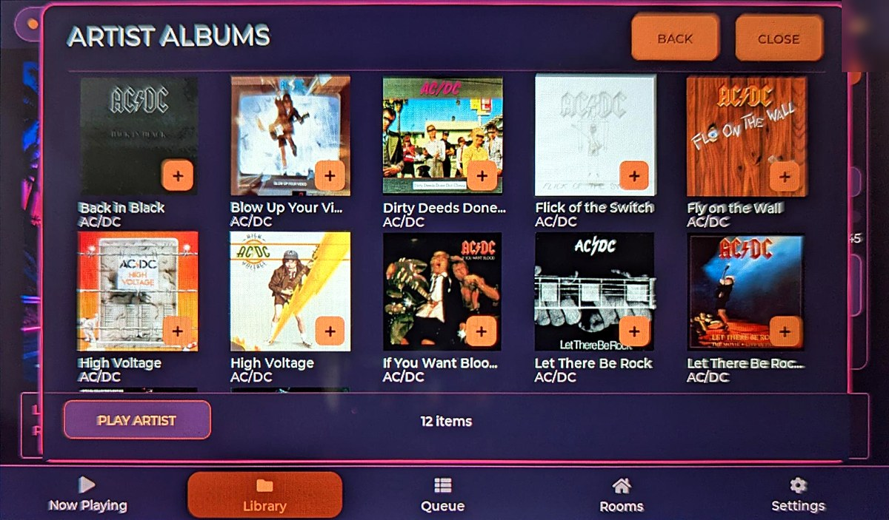
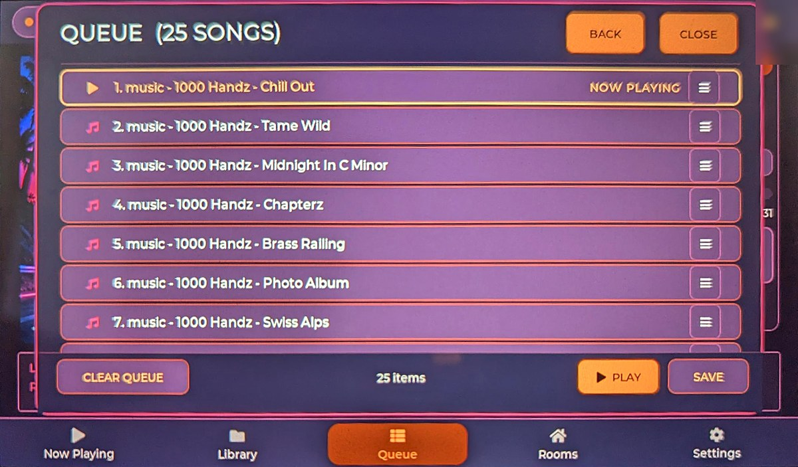
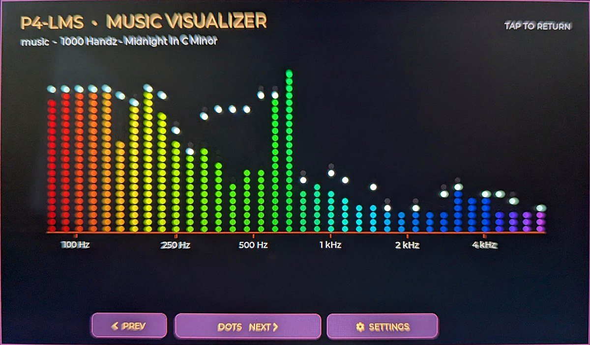
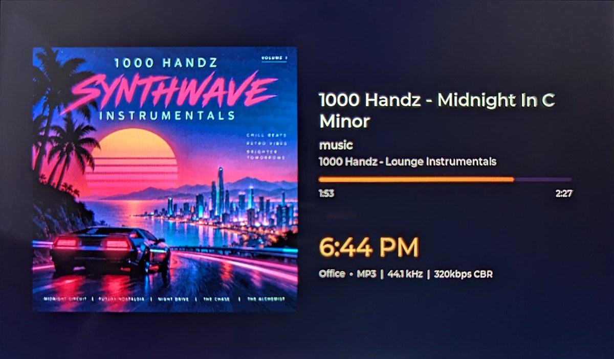
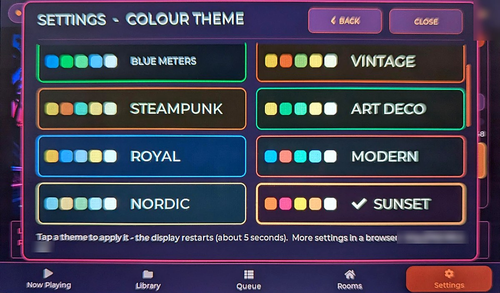

# P4-LMS

A 7" touchscreen controller for whole-house music, built on a Waveshare ESP32-P4 display board. It controls a [Lyrion Music Server](https://lyrion.org/) (formerly Logitech Media Server) and can switch amplifiers on and off through [Home Assistant](https://www.home-assistant.io/).



## Features

- **Now Playing:** cover art, track info, play/pause/skip, volume with −/+ buttons and one-tap mute, and a live VU meter from the board's microphone
- **Rooms:** every player on one screen, with what's playing, its volume, one-tap room switching and grouping rooms to play in sync
- **System power:** one switch per room turns the amp (and an optional pre-amp) on and off through Home Assistant, in a configurable order with a delay, so there's no speaker thump. A power button on Now Playing does the same for the current room
- **Music browsing:** artists, albums with cover art, genres, folders, search, favourites, and picking several songs at once. Lists scroll and keep loading as you go, even in large libraries
- **Queue editing:** the whole queue scrolls with the playing song marked; move songs, play next, remove, favourite, add to a playlist
- **Saved playlists:** create, add to, reorder, rename, and play from any song
- **Internet radio and apps,** including YouTube search (with Lyrion's YouTube plugin)
- **Visualizers:** several styles driven by the built-in microphone, with adjustable sensitivity
- **Colour themes**
- **Screensavers:** album art, cover wall, big text, VU meters, clocks, and weather with a 3-day forecast (Open-Meteo, no account needed); the clock has 5 fonts, 4 sizes, 12/24-hour time, date styles and colours
- **Sleep timer and alarms** that power the amps down and up in order
- **Web settings page:** Home Assistant setup, power switches, weather location, time zone, settings backup/restore, and firmware updates over Wi-Fi
- **Location profiles:** remembers a separate Lyrion server and players for each Wi-Fi network

## Screenshots

<table>
<tr>
<td><br><b>Rooms</b>: every player, its volume and system power</td>
<td><br><b>Library</b>: albums with cover art</td>
</tr>
<tr>
<td><br><b>Queue</b>: move, remove, save as a playlist</td>
<td><br><b>Visualizer</b>: driven by the built-in microphone</td>
</tr>
<tr>
<td><br><b>Screensavers</b>: album art, clocks, weather and more</td>
<td><br><b>Colour themes</b></td>
</tr>
</table>

## Hardware

- [Waveshare ESP32-P4-WIFI6-Touch-LCD-7B](https://www.waveshare.com/esp32-p4-wifi6-touch-lcd-7b.htm) (7", 1024×600, ESP32-P4 with an ESP32-C6 for Wi-Fi)
- A Lyrion Music Server on your network, with at least one player (for example [Squeezelite-ESP32](https://github.com/sle118/squeezelite-esp32) streamers)
- Optional: Home Assistant with switch entities for your amps and pre-amps

## Install the ready-made firmware

1. Download the firmware from the [Releases](../../releases) page: `P4-LMS-vX.Y.bin` for most boards, or `P4-LMS-vX.Y-chip-v3.bin` for [newer boards with a v3 chip](#newer-boards-chip-v3). If you're not sure, try the first one: the flash tool prints the chip revision when it connects.
2. Connect the board to your computer with a USB-C cable.
3. Flash it with either:
   - **In a browser:** open the [ESP web flasher](https://espressif.github.io/esptool-js/) in Chrome or Edge, click **Connect**, choose the board's port, set the address to **0x0**, pick the `.bin` file, and click **Program**.
   - **From a terminal:** `esptool.py --chip esp32p4 -b 460800 write_flash 0x0 P4-LMS-vX.Y.bin`
4. The display restarts when it's done.

## First-time setup

On its first start the display walks you through the first two steps by itself: it opens the Wi-Fi picker, then (if it can't find your server on its own) the Lyrion server finder.

1. **Wi-Fi:** choose your network and enter its password. To change it later: **Settings › Wi-Fi**, tap **SCAN**.
2. **Lyrion server:** choose your server from the list; the display restarts with that server's players. To change it later: **Settings › Lyrion server** › **FIND SERVERS**.
3. **Web settings:** open `http://p4lms.local/` in a browser, or scan the QR code on **Settings › About** with your phone (the About screen also shows the IP address if `p4lms.local` doesn't work on your network). There you can set:
   - your **time zone** and **weather location**
   - **Home Assistant:** its address and a long-lived access token (in Home Assistant: your profile › Security › Long-lived access tokens). The page shows whether it connected (**Test** checks again), and with an administrator's token it suggests your switch names as you type.
   - **power switches** for each player, with the pre-amp order and delay
4. **Back up** your settings from the bottom of the web page once everything is set.

## Updating

Later versions can be installed from the web settings page: **Firmware update** › choose `P4-LMS.bin` from the Releases page (or `P4-LMS-chip-v3.bin` for a [chip v3 board](#newer-boards-chip-v3)) › **Install**. Use these update files, not the larger `P4-LMS-vX.Y` files, which are for a first install over USB. If a new version fails to start properly, the display goes back to the previous one by itself.

## Android app

There's also an Android version of the same controller, for tablets, phones and repurposed smart displays. Download `P4LMS-Android-X.Y.apk` from the [Releases](../../releases) page and open it on the device (you may need to allow installing apps from your browser or file manager). It's a side project, so expect a few rough edges.

## Building from source

Requires [ESP-IDF](https://docs.espressif.com/projects/esp-idf/) v5.5.

```
idf.py set-target esp32p4
idf.py menuconfig        # optional: "P4-LMS WiFi Configuration" for a built-in network
idf.py build
idf.py -p <PORT> flash monitor
```

To make a single combined file for the Releases page: `idf.py merge-bin` (creates `build/merged-binary.bin`).

### Newer boards (chip v3)

Boards made from mid-2026 can have an ESP32-P4 chip revision **v3.x** (the flash tool says e.g. "this chip is revision v3.2"). Firmware for v1.x chips does not run on v3.x chips, and the other way round, so build those boards with the extra `sdkconfig.defaults.rev3` settings in a separate build folder:

```
idf.py -B build-v3 -D SDKCONFIG=sdkconfig.v3 -D SDKCONFIG_DEFAULTS="sdkconfig.defaults;sdkconfig.defaults.rev3" build
idf.py -B build-v3 -D SDKCONFIG=sdkconfig.v3 -p <PORT> flash monitor
```

For web updates on a v3 board use `build-v3/P4-LMS.bin`; the update page refuses a file built for the other chip revision.

Board-specific defaults (starting server address, time zone, and more) are at the top of `main/parts/02_config.c`. The code is split into numbered files in `main/parts/`, which `main/main.c` includes in order.

## Known limitations

- Built and tested on one board, the Waveshare ESP32-P4-WIFI6-Touch-LCD-7B. Other ESP32-P4 boards need changes.
- Tested with ESP-IDF 5.5 and a recent Lyrion Music Server, with up to four players shown.
- The web settings page has no password. Use it on a home network you trust.
- The web page and the connection to Home Assistant use plain HTTP on your local network.
- Tested in one home with one set of players and switches. If something doesn't work with yours, please open an Issue with the serial log (`idf.py monitor`).

## About this project

I'm a hardware hobbyist, not a programmer. The software was written with the help of AI (Anthropic's Claude): I described what I wanted, tested every version on the real hardware, and reported back what worked until it all came together.

## Support

P4-LMS is free and always will be. If it's added something to your music setup and you'd like to say thanks, you can buy me a coffee:

[](https://ko-fi.com/allgood65)

Bug reports and ideas in [Issues](../../issues) are just as welcome.

## License

MIT - see [LICENSE](LICENSE). Third-party components and their licenses are listed in [THIRD_PARTY_NOTICES.md](THIRD_PARTY_NOTICES.md).
